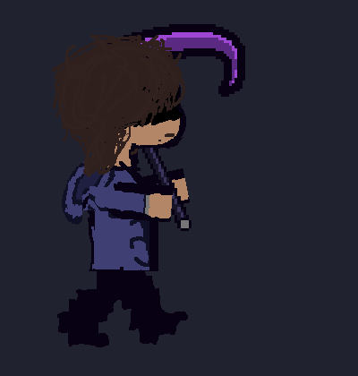

# DIGIPURITY

<p align="center">
  
</p>

<p align="center">
  <strong>A 2D futuristic cyber-RPG synthesizing tactical coin-clashing, real-time bullet evasion, and permanent moral polarity in a decaying digital world.</strong>
</p>

<p align="center">
  
  
  
  
</p>

---

## 📖 Overview & Premise

**DIGIPURITY** follows **Owen**, a pre-digital human drawn into a decomposing digital realm corrupted by unstable **"AI Slop"** entities. Navigating through decaying sectors, Owen must solve traversal puzzles, engage in hybrid card-and-evasion battles, build specialized keyword loadouts, and make a permanent ethical choice at the close of every encounter:

* **[PURIFY]**: Cleanses the entity, restores sector infrastructure and world power grids, earns positive NPC dialogue, awards baseline EXP ($1.0\times$), and steers toward the **Peaceful Rest Ending**.
* **[PURGE]**: Obliterates the code, grants **$+50\%$ bonus EXP ($1.5\times$)** and aggressive stat growth, but accelerates systemic infrastructure collapse toward the **Dying Digital World Ending**.

---

## ⚔️ The 4-Way Mechanical Combat Synthesis

DIGIPURITY’s combat architecture synthesizes four foundational mechanical systems:

```
                          ┌───────────────────────────┐
                          │         DIGIPURITY        │
                          │      COMBAT SYNTHESIS     │
                          └─────────────┬─────────────┘
                                        │
        ┌───────────────────┬───────────┴───────────┬───────────────────┐
        ▼                   ▼                       ▼                   ▼
┌───────────────┐   ┌───────────────┐       ┌───────────────┐   ┌───────────────┐
│LIMBUS COMPANY │   │   UNDERTALE   │       │   DELTARUNE   │   │  OFF (MORTIS) │
├───────────────┤   ├───────────────┤       ├───────────────┤   ├───────────────┤
│• Coin Flips   │   │• Bullet-Hell  │       │• Tension (TP) │   │• 4 Fixed Zones│
│• Clashing     │   │  Evasion Box  │       │  Economy      │   │• Level Caps   │
│• Dynamic Slots│   │• Focus Slow   │       │• Bullet Graze │   │• Encounter    │
│• Charge Pool  │   │• invc i-frames│       │  Gain         │   │  Limits (25)  │
└───────────────┘   └───────────────┘       └───────────────┘   └───────────────┘
```

### 1. Limbus Company — Coins, Clashing & Expanding Slots
* **Expanding Skill Slots**: Active combat slots expand each turn ($1 \to 6$), widening tactical choices as fights escalate.
* **Coin Clashing**: Opposing skills clash round-by-round. Total power ($\text{BasePower} + \sum \text{Heads} \times \text{CoinPower}$) determines the round winner; losers permanently lose a coin for that clash until one side breaks through for unopposed damage.
* **Charge & Sanity Conversion**: Charge sits between **$-45$ (Drained)** and **$+45$ (Overcharged)**, directly modulating Heads probability:
  $$P(\text{Heads}) = \text{Clamp}\left(0.50 + \frac{\text{Charge}}{100},\; 0.05,\; 0.95\right)$$
* **Click-to-Toggle Defense**: Click any active skill slot or portrait to instantly substitute standard attack cards with `Guard`, `Evade`, or `Counter`.

### 2. Undertale — Real-Time Bullet Evasion
* When enemy attacks go uncontested or break through Owen's clashes, the game transitions into a real-time bounded bullet-hell arena.
* Move Owen’s Soul with precision focus slowing ($50\%$ speed on `Shift` / `X`) and invulnerability frame safeguards (`invc`).

### 3. Deltarune — Tension Points (TP) & Grazing
* **Tension Points (TP)**: Internal pool of $0\text{–}250$ displayed as $0\text{–}100\%$.
* Generated by choosing to Defend ($+40\text{ TP} / 16\%$) and **Grazing** bullets inside the dodge box within close proximity without taking damage.
* Spent strategically to fuel high-tier skills and amplify Charge.

### 4. OFF (Mortis Ghost) — Strict Zones & Competence Progression
* **4 Main Cyber Zones** with strict encounter caps ($25$ max encounters per zone) to prevent mindless grinding.
* **Zonal Level Caps**:
  * Zone 1: Level **25**
  * Zone 2: Level **50**
  * Zone 3: Level **75**
  * Zone 4: Level **100**

---

## 🧬 Status Keywords & Hybrid Fusions

| Keyword | Mechanical Behavior |
| :--- | :--- |
| **Burn** | Inflicts fixed turn-end damage equal to Potency; Count decreases by 1. |
| **Bleed** | Inflicts fixed damage equal to Potency whenever an attack coin is flipped; Count decays by 1. |
| **Poise** | Grants a Potency% chance to deal critical strike damage on hit; Count decays on crit. |
| **Drainage** | Directly drains the target's Charge pool, tanking their coin flip probabilities. |
| **Stutter / Glitch** | Stutter elevates the Glitch Threshold. When $\text{HP} \le \text{Threshold}$, targets enter the **Glitched State**, freezing up and skipping their turn. |

### ⚡ 4 Rare Hybrid Fusions
Equipping dual **Resonance Core** items fuses base keywords into devastating hybrid effects:
1. **Burn + Stutter $\to$ `StutterScorch`**: Turn-end burn damage accelerates glitch threshold elevation.
2. **Poise + Bleed $\to$ `CrimsonLacerate`**: Critical coin flips inflict double bleed damage.
3. **Drainage + Stutter $\to$ `StaticSeizure`**: Draining enemy Charge elevates their Glitch threshold by the drained amount.
4. **Burn + Poise $\to$ `CobaltCombustion` (Blue Burn)**: Consumes Poise count at turn end to unleash **$1.5\times$ Critical Burn damage**.

---

## 🎮 Overworld Controls & Exploration

Owen explores cyber sectors with authentic Deltarune/Undertale-style movement physics:

| Action | Key / Input | Notes |
| :--- | :--- | :--- |
| **Move** | `W`, `A`, `S`, `D` or Arrow Keys | 4-directional movement with smart diagonal facing retention |
| **Diagonal Move** | Any 2 directional inputs | **$1.5\times$ speed multiplier** with accelerated step cadence |
| **Run / Sprint** | Hold `Left Shift`, `Right Shift`, or `X` | $1.6\times$ run multiplier ($2.4\times$ combined diagonal sprint) |
| **Inspect / Interact** | `Z` / `Enter` | Trigger dialogues, examine terminals, engage encounters |

---

## 📁 Repository Structure

```text
DIGIPURITY/
├── Assets/
│   ├── Animations/               # Overworld controller animator graphs
│   ├── Scenes/
│   │   └── SampleScene.unity     # Overworld test arena with WalkableSquare clamping
│   ├── Scripts/
│   │   ├── Combat/               # Coin clash resolver, deck manager, soul logic, keywords
│   │   ├── Core/                 # JSON save system, prologue tutorial onboarding
│   │   └── World/                # OverworldPlayerController with 1.5x diagonal physics
│   ├── Sprites/
│   │   ├── Environment/          # Walkable squares and room boundaries
│   │   └── Owen/                 # 27 directional walk/idle sprites & Scythe battle sheets
│   └── Tests/
│       └── EditMode/             # NUnit test suites for combat, keywords, and movement
├── LibreSprite_Files/            # Raw Aseprite master project & layer source files
├── ProjectSettings/              # Unity 6000.6.0f1 URP 2D engine configuration
└── README.md
```

---

## 🧪 Automated Test Suite

DIGIPURITY maintains full EditMode unit test coverage in `Assets/Tests/EditMode/`:
* `CombatSystemTests.cs`: Coin clash math, Charge probabilities, and Soul movement speed halving.
* `OverworldMovementTests.cs`: Cardinal speed ($1.0\times$), diagonal speed ($1.5\times$), and diagonal sprint ($2.4\times$).
* `DefenseSkillSwapTests.cs`: Tap-to-swap defense skill mechanics.
* `HybridCombatTests.cs` & `HybridKeywordCombinationTests.cs`: Resonance Core detection and keyword triggers.
* `KeywordAndLevelProgressionTests.cs`: Purge $1.5\times$ EXP math and zonal level cap enforcement.

---

## 👤 Author & Credits

* **Lead Developer & Designer**: **Cole Blair** ([@0-cole](https://github.com/0-cole))
* **Framework**: Unity 6000.6.0f1 (Universal 2D)
* **Inspired By**: *Limbus Company* (Project Moon), *Undertale* / *Deltarune* (Toby Fox), and *OFF* (Mortis Ghost).
